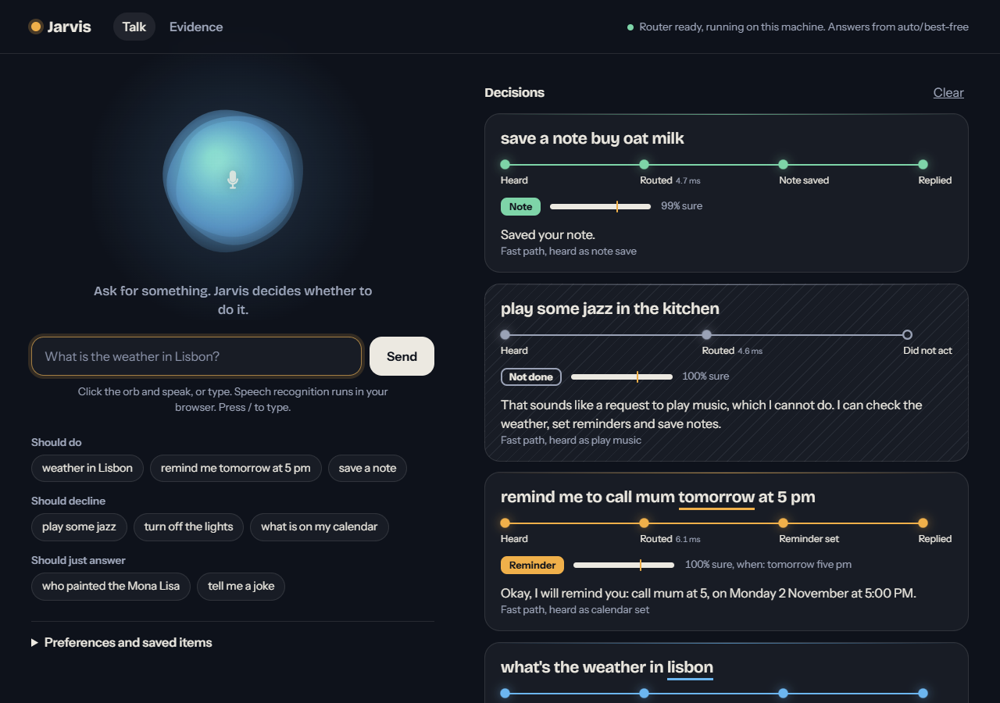
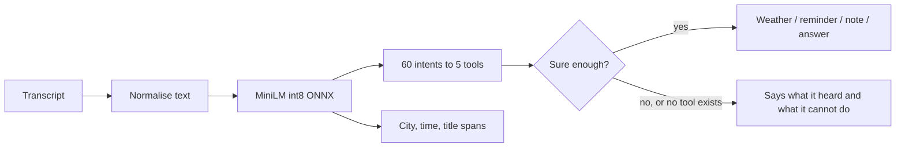

# Jarvis: a voice assistant that knows when not to act

[](https://github.com/brej-29/jarvis-voice-agent/actions/workflows/ci.yml)

A local voice assistant router. It reads what you said, picks one of five outcomes (weather, reminder, note, answer, or "I cannot do that") in about 2 ms on one CPU thread, and says plainly when it has no tool for a request.

**Live demo:** https://brej-29.github.io/jarvis-voice-agent/ (free, no server: the router runs in your browser, see [limits](#free-hosting-and-limits)).
**Windows app:** `make exe` builds a single `jarvis.exe` that runs the same app offline on your machine, no Python needed (see [Run it](#run-it)). I have not published a prebuilt copy.



## The problem

Jarvis V1 was a Flutter app that sent every request to a small local LLM with a prompt that said "reply with JSON naming a tool". It worked in demos. Nobody had measured it, and a voice assistant that acts on the wrong request is worse than one that says "I cannot do that": a wrong reminder gets created, a note gets saved, or it claims to play music it cannot play.

So the question became: **how often does a prompted small LLM pick the wrong tool, how often does it act when it should decline, and what is the cheapest thing that does better?** And because the text really comes from a microphone: **what happens to all of that when the text is a speech recognizer's guess?**

## Evidence that the problem is real

Every number below is in `bench/results/*.json` and reproducible with the commands in [Reproduce](#reproduce). Thresholds were written down before anything was trained: [`docs/PREREG.md`](docs/PREREG.md).

**Benchmark.** MASSIVE en-US (Amazon, CC BY 4.0), 2,805 test requests, mapped to Jarvis's tools plus a new `UNSUPPORTED` label. Score: macro-F1 over {weather, reminder, note, do-nothing}. "False action" is the share of requests it should have declined that it acted on. LLM systems run on a fixed stratified subset of 539 requests, so every row sees the same questions.

| System (539-request subset) | Macro-F1 (95% CI) | False actions | Valid JSON | Median latency |
|---|---|---|---|---|
| **Jarvis V1 prompt, Qwen2.5 1.5B** | 0.49 (0.45 to 0.54) | 41% | 55% | 3.3 s |
| Jarvis V1 prompt, Qwen2.5 0.5B | 0.30 (0.27 to 0.33) | 83% | 80% | 1.5 s (loaded) |
| Jarvis V1 prompt, Mistral 7B (V1's default family) | 0.20 (0.18 to 0.22) | 49% | 0% | 9.0 s (GPU) |
| Same V1 prompt without the pasted project docs, 1.5B | 0.67 | 44% | 91% | 4.1 s (loaded) |
| Short prompt, constrained JSON, Qwen2.5 1.5B | 0.88 (0.84 to 0.91) | 3.7% | 100% | 1.0 s |
| Short prompt, constrained JSON, Mistral 7B | 0.79 (0.74 to 0.84) | 10% | 100% | 0.8 s (GPU) |
| Keyword rules | 0.84 (0.80 to 0.87) | 8.7% | n/a | 0.004 ms |
| **Jarvis now (joint model)** | **0.95 (0.93 to 0.98)** | **1.7%** | n/a | **2.2 ms** |

What the baseline run showed:

- The V1 prompt never produced an "unsupported" answer (it had no such label), so every unsupported request was answered as chat. Mistral 7B ignored the JSON instruction altogether and replied in prose, inventing a weather-API call. In 539 requests it produced valid JSON zero times.
- The prompt pasted in 1,600 characters of the project's own docs. Removing them lifted macro-F1 from 0.49 to 0.67 and valid output from 55% to 91%. The docs were noise.
- Running V1's code also showed two plain bugs ([`bench/results/v1_bugs.json`](bench/results/v1_bugs.json), reproduce with `make repro`): saving a note crashed with `NameError: name 'datetime' is not defined`, and the "repair the bad JSON" retry was sent the exception message, not the model's output.

Latency in that table is from `bench/results/latency.json` (idle machine) for the 1.5B rows, and from the accuracy runs (other jobs sharing the CPU) where marked "loaded".

## Approach

One small encoder (MiniLM-L6, 22M parameters, int8 ONNX, 23 MB) reads the request once and produces two things: which of 60 fine intents it is, and which words are the city, the time and the event. The fine intents are summed into the five tools. If the summed probability of an action tool is below a threshold tuned on the dev set, Jarvis declines instead of acting.



More in [`docs/ARCHITECTURE.md`](docs/ARCHITECTURE.md).

## Results

Full test set (2,805 requests), clean text:

| System | Macro-F1 (95% CI) | False actions | Said "cannot" when it should | City right | Time right |
|---|---|---|---|---|---|
| Keyword rules | 0.71 (0.68 to 0.74) | 9.9% | 65% | 83% | 49% |
| TF-IDF + logistic regression | 0.93 (0.91 to 0.95) | 0.7% | 98% | 85% | 47% |
| Joint model, MASSIVE only (pre-registered) | 0.95 (0.93 to 0.97), 3 seeds 0.951 ± 0.004 | 0.4% | 99% | 98% | 85% |
| **Joint model, shipped** | **0.94 (0.92 to 0.96) for seed 0, 3 seeds 0.948 ± 0.005** | **0.6%** | **99%** | **98%** | **85%** |

- Choosing the tool is mostly easy: a linear model gets within about 1 to 2 points. The transformer earns its place on arguments (city 85% to 98%, time 47% to 85%).
- The shipped model trades a little clean-text score for notes and a wake word ("hey jarvis"), neither of which MASSIVE contains. Both models are reported.
- Many remaining misses are label noise in MASSIVE (for example "by get marks" is labelled as a weather request). The ceiling is below 1.0.

### Real speech is the harder problem

I played 494 real recordings (SLURP headset and far-field, sentences not seen in training) through Whisper and routed the transcripts, scoring the same requests on gold text and on speech.

| Router | Gold text | Whisper base.en transcripts | False actions on speech |
|---|---|---|---|
| Keyword rules | 0.81 | 0.76 | 5.3% |
| TF-IDF + linear | 0.90 | 0.79 | 1.3% |
| Joint model, MASSIVE only | 0.94 | 0.80 | 3.0% |
| **Joint model, shipped** | **0.95** | **0.84** | **2.3%** |
| Short prompt, Qwen 1.5B | 0.81 | 0.73 | 5.3% |

Routing from speech loses 10 points, and Whisper base.en got 26% of words wrong on this set. Training on 6,600 recogniser transcripts bought 1 to 2 points on speech (0.822 to 0.831 on average over seeds) and left false actions about where they were. The better lever is the recogniser:

| Whisper model | Word error rate | Macro-F1 of the shipped router | False actions |
|---|---|---|---|
| tiny.en | 34% | 0.85 | 2.7% |
| base.en | 26% | 0.84 | 2.3% |
| small.en | 20% | 0.88 | 2.3% |
| medium.en | 17% | 0.93 | 2.0% |

With medium.en the router is 1.7 points below its gold-text score. The tiny/base ordering is inside the noise (494 clips, intervals about ±4 points).

### The safety dial

Threshold on the summed tool probability, shipped model:

| Threshold | Text: false actions / missed | Speech: false actions / missed |
|---|---|---|
| 0.0 (never decline) | 1.1% / 5.2% | 2.7% / 17.0% |
| 0.8 | 0.6% / 7.6% | 1.7% / 20.1% |
| 0.9 | 0.3% / 8.3% | 1.7% / 23.2% |
| 0.99 | 0.1% / 19.6% | 0.3% / 39.2% |

### What did not work

- **LLM fallback.** A cascade that sends unsure requests to the 1.5B model scored 0.94 against 0.95 for the router alone, with a 95th percentile of 1.4 s. The fallback made routing slower and no better, so the shipped router abstains instead.
- **Bigger model.** Mistral 7B with the same short prompt scored 0.79, below the 1.5B Qwen (0.88), and acted on 10% of requests it should decline.
- **Pre-registered goals.** T1 (clean macro-F1 at least 0.95) was met by the MASSIVE-only model and missed by a hair by the shipped one. T6 (at most 5 points lost on speech) was missed with Whisper base.en and met with medium.en. T4's +10 points over the best V1-prompt result is met by a wide margin (+46), but against the fair constrained-prompt baseline the gain is +7.4 points (CI 3.8 to 11.2).

Pre-registered goals, all seven:

| Goal | Target | Result |
|---|---|---|
| T1 clean macro-F1 | at least 0.95 | 0.951 MASSIVE-only (met), 0.948 shipped (missed by 0.002) |
| T2 false actions | at most 2% | 0.6% (met) |
| T3 latency p95 | at most 25 ms | 3.4 ms (met) |
| T4 gain over V1 prompt | at least 10 points | +46 points (met); +7.4 over the constrained prompt |
| T5 arguments | city 90%, time 75% | 98%, 85% (met) |
| T6 speech drop | at most 5 points | 10 with base.en (missed), 1.7 with medium.en (met) |
| T7 says "cannot" | at least 85% | 99% (met) |

## Run it

Needs Python 3.11 and [uv](https://docs.astral.sh/uv/).

```bash
uv venv --python 3.11 .venv
uv pip install --python .venv/Scripts/python.exe -e .
.venv/Scripts/python.exe -m jarvis          # opens http://127.0.0.1:8765
```

Voice input uses your browser's speech recognition (Chrome or Edge); typing works everywhere. Reminders become browser notifications and notes are kept on the device.

General questions ("who painted the Mona Lisa") need a language model, and the router never needs one. Point Jarvis at any OpenAI-compatible endpoint (a local gateway such as OmniRoute, Ollama's `/v1`, llama.cpp server):

```bash
set JARVIS_LLM_BASE_URL=http://localhost:11434/v1
set JARVIS_LLM_MODEL=qwen2.5:1.5b
set JARVIS_LLM_API_KEY=...        # only if the endpoint needs one
```

**Windows exe:** `make exe` builds `dist/jarvis.exe` with PyInstaller (UI and model inside, 63 MB, no Python needed). It opens your browser on `http://127.0.0.1:8765`. A build made from this commit was smoke-tested over HTTP (health, reminder, greeting). The file is unsigned, so Windows SmartScreen may warn.

## Reproduce

```bash
make setup           # venv, torch (CUDA), eval dependencies, llama.cpp wheel
make eval            # rules, TF-IDF and joint models on the full test set (about a minute)
make train           # three seeds of the joint model (a few minutes on a laptop GPU)
make eval-llm        # LLM baselines on the subset (about an hour on CPU; downloads GGUF files)
python bench/summarize.py   # rebuilds bench/results/SUMMARY.md and the Evidence page data
```

Data is downloaded by the scripts: MASSIVE from Amazon's S3 bucket, SLURP recordings from the Hugging Face `qmeeus/slurp` copy, Whisper models from Hugging Face. Speech scripts: `python -m jarvis.bench.asr` (evaluation clips) and `python -m jarvis.bench.asr_train` (training transcripts). Audio is never committed.

## Free hosting and limits

- **Live demo** is a static site on GitHub Pages, rebuilt from `main` by `.github/workflows/pages.yml`. There is no server, so there is no cold start and nothing to sleep. The same 23 MB int8 model runs in your browser through onnxruntime-web (WASM). Routing takes about 30 ms there, and the browser router agrees with the Python router on the tool for all 604 requests I compared (confidence differs by up to 0.05 because the int8 kernels differ).
- First visit downloads the model (23 MB) and the onnxruntime WASM runtime (11 MB), both from the same site, so the first request waits a few seconds. The page says so while it loads. The page loads no third-party scripts: onnxruntime-web is fetched at build time from a pinned release and checked against a SHA-256 hash (`packaging/vendor.json`), chrono-node is vendored, and a Content-Security-Policy limits connections to the site and Open-Meteo.
- Weather calls go from your browser to Open-Meteo (free, no key, fair-use limits). Reminders and notes stay in your browser's storage.
- The hosted copy has no language model, so "general questions" explain how to connect one. Run it locally for that.
- Voice input uses the browser's own speech recognition (Chrome or Edge). Typing works anywhere.
- GitHub Pages limits (1 GB site, soft bandwidth cap) are far above this site's size. Hugging Face Docker Spaces were the first plan, but the free CPU tier now requires a PRO subscription, so I did not use it.
- Nothing here depends on a paid service, and every endpoint and model id is configuration.

## Limits

- The tool mapping is a proxy: reminders come from MASSIVE's alarm and calendar requests, notes from list requests. Notes were taught with synthetic phrasings and are not measured on real data.
- Speech results use Whisper (int8, English) on 494 clips from one corpus. Browser speech recognition, which the app actually uses, was not benchmarked.
- Only the three action tools are gated by the confidence threshold. A garbled request that the model guesses is a general question still goes to the language model, if one is connected.
- Cascade fallback is set to a 15% dev quantile of confidence, which is near 0.99 because the model is very sure most of the time, so the real fallback rate on test differs from 15%.
- A few ASR training transcripts (sentences that also got a wake-word variant) were dropped when tags were aligned, so the speech training set is slightly smaller than the 6,600 rows quoted.
- English only. One laptop (i5-13450HX, RTX 3050 6 GB). Latency is router time only.
- Time arguments are right 85% of the time given the right tool. I did not break the failures down further.

## Data and licences

MASSIVE is CC BY 4.0 (FitzGerald et al., 2022, Amazon). SLURP text is CC BY 4.0; its recordings are CC BY-NC 4.0 and are used here for evaluation and research only, never redistributed (Bastianelli et al., 2020). Qwen2.5 0.5B and 1.5B are Apache 2.0; Mistral 7B Instruct v0.3 is Apache 2.0. MiniLM (`nreimers/MiniLM-L6-H384-uncased`) is MIT. Code is MIT.

## Repository

| Path | What |
|---|---|
| `jarvis/` | Router, tools, server, UI, benchmark harness |
| `training/` | Training script and synthetic data |
| `bench/` | `results/` (every number), `summarize.py`, V1 bug reproduction |
| `docs/` | `PREREG.md`, `ARCHITECTURE.md` |
| `models/joint/` | The shipped int8 model |
| `packaging/` | PyInstaller spec and the GitHub Pages site builder |
| `Dockerfile` | Container for self-hosting the server version |
